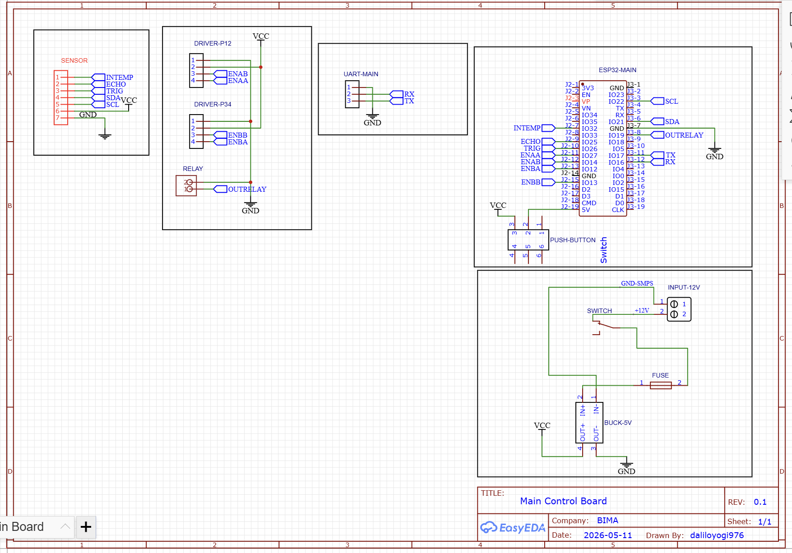
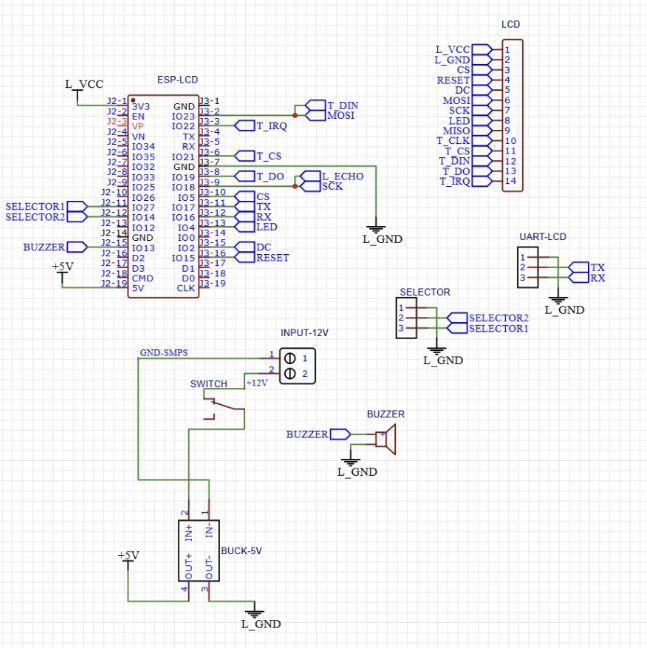

# HICS Firmware

Firmware for **HICS**, a hydroponic controller that monitors a nutrient tank, doses pH and nutrient solutions automatically, and syncs with a mobile/web app through Firebase. Built by Tim VoltX.

The system is two ESP32 boards that talk to each other over UART:

| PlatformIO env | Source | Role |
|---|---|---|
| `esp32_main` | [src/mainBoard/main.cpp](src/mainBoard/main.cpp) | Reads sensors, drives pumps, runs auto-dosing, syncs with Firebase |
| `esp32_lcd` | [src/lcdBoard/lcd_main.cpp](src/lcdBoard/lcd_main.cpp) | ILI9341 touch UI, mode selector switch, buzzer |

```
 Sensors ──► ┌────────────┐  UART 115200  ┌───────────┐
 Pumps   ◄── │ ESP32-MAIN │ ◄───────────► │ ESP32-LCD │ ◄── touch / selector
             └─────┬──────┘  JSON lines   └───────────┘
                   │ WiFi
                   ▼
              Firebase RTDB ◄──► Mobile / web app
```

## Contents

- [Features](#features)
- [Getting started](#getting-started)
- [Hardware](#hardware)
- [How auto mode works](#how-auto-mode-works)
- [Firebase data model](#firebase-data-model)
- [LCD interface](#lcd-interface)
- [Main ↔ LCD UART protocol](#main--lcd-uart-protocol)
- [Calibration](#calibration)
- [Project layout](#project-layout)
- [Troubleshooting](#troubleshooting)

## Features

- **Sensing**: pH, nutrient concentration (TDS/ppm), water temperature, air temperature and humidity, water level.
- **Two control modes**:
  - **AUTO**: doses pH Up / pH Down / Nutrient A+B to keep readings inside configurable limits, and cycles the circulation pump on a timer.
  - **MANUAL**: each pump is switched by hand from the LCD or the app.
- **Safety interlocks**: dosing and the circulation pump stop when the tank is low or the water-level sensor fails. pH and nutrient pumps never run at the same time.
- **Firebase sync**: live telemetry, hourly history, push-style alerts, and remote settings and commands.
- **Offline operation**: if WiFi or Firebase is unavailable, the device keeps sensing and dosing using the last settings saved in flash.
- **On-device calibration** of pH (2-point), TDS (1-point) and each peristaltic pump's flow rate.
- **WiFi provisioning from the LCD**: scan networks and type a password on the on-screen keyboard. The network is remembered across reboots.

## Getting started

### Requirements

- [PlatformIO](https://platformio.org/) (CLI or the VS Code extension)
- Two ESP32 DevKit boards (`esp32dev`)
- A Firebase project with a Realtime Database and an Email/Password user for the device

### 1. Create `secrets.h`

Credentials live in a git-ignored header. Copy the template and fill it in:

```
cp src/mainBoard/secrets.h.example src/mainBoard/secrets.h
```

| Define | Meaning |
|---|---|
| `FIREBASE_API_KEY` | Web API key from Firebase project settings |
| `FIREBASE_DATABASE_URL` | Realtime Database URL, e.g. `https://<project>-default-rtdb.firebaseio.com` |
| `FIREBASE_EMAIL` / `FIREBASE_PASSWORD` | Email/Password user the device signs in as |
| `WIFI_SSID` / `WIFI_PASS` | Default WiFi, used on first boot until a network is chosen on the LCD |
| `DEVICE_ID` | Name of this unit in the database (`/Hics/<DEVICE_ID>/...`). Defaults to `hics2026` if undefined |

To provision another unit, change `DEVICE_ID` in its `secrets.h` and flash it. Nothing else needs editing.

Only the main board needs `secrets.h`. The LCD board gets its WiFi details from the main board over UART.

### 2. Build and flash

Flash each board with its own environment:

```
pio run -e esp32_main -t upload
pio run -e esp32_lcd  -t upload
```

Open the serial monitor (115200 baud) with `pio device monitor -e esp32_main`. Add `-p COMx` if more than one board is connected.

### Bench testing without pumps

In [main.cpp](src/mainBoard/main.cpp) set `#define ACTUATORS_ENABLED 0` to disable all pump outputs. Individual sensors can also be replaced with dummy values from the app through `/setting/debugSensor` (see [Firebase data model](#firebase-data-model)).

## Hardware

Schematics (EasyEDA, rev 0.1): [Main board](sch/mainSch.png) · [LCD board](sch/lcdSch.png)




> **The code is the source of truth for pins.** The main-board schematic still shows the older motor-driver pin names (`ENAA`, `ENAB`, …) from before the dosing pumps moved to a relay module. Use the tables below when wiring.

### Main board (`esp32_main`)

| Function | GPIO | Notes |
|---|---|---|
| pH Up pump | 13 | Relay, active-LOW |
| pH Down pump | 33 | Relay, active-LOW. Moved off GPIO12, a boot strapping pin |
| Nutrient A pump | 14 | Relay, active-LOW |
| Nutrient B pump | 27 | Relay, active-LOW |
| Circulation (water) pump | 19 | SSR, active-HIGH |
| DS18B20 (water temperature) | 32 | One-Wire |
| Ultrasonic TRIG / ECHO | 25 / 26 | JSN / AJ-SR04M waterproof sensor |
| I²C SDA / SCL | 21 / 22 | ADS1115 and AHT10 |
| UART to LCD, RX2 / TX2 | 16 / 17 | Cross-wired to the LCD board; share GND |

I²C devices:

| Device | Measures |
|---|---|
| ADS1115 | pH on channel A0, TDS on channel A1 |
| AHT10 | Air temperature and humidity |

Power: 12 V input → fuse → switch → 5 V buck converter for the ESP32 and logic (see the schematic).

### LCD board (`esp32_lcd`)

| Function | GPIO |
|---|---|
| TFT CS / DC / RST / backlight | 5 / 2 / 15 / 4 |
| Touch CS / IRQ | 21 / 22 |
| SPI SCK / MISO / MOSI | 18 / 19 / 23 (default VSPI) |
| Mode selector, MANUAL / AUTO | 27 / 14 (input pull-up) |
| Buzzer | 13 |
| UART to main, RX2 / TX2 | 16 / 17 |

Display: ILI9341 TFT with XPT2046 resistive touch. Touch limits are set by `TOUCH_X_MIN/MAX` and `TOUCH_Y_MIN/MAX` at the top of [lcd_main.cpp](src/lcdBoard/lcd_main.cpp).

## How auto mode works

`controlAuto()` runs continuously while the mode is AUTO. Settings come from the `/setting` node (see below), with defaults in parentheses.

**1. Water-level interlock.** If the water level is at or below `waterLowPct` (5 %), or the ultrasonic sensor is untrusted, all dosing and the circulation pump stop. When the level recovers the pump cycle restarts from zero. The sensor is untrusted after 5 failed measurement bursts in a row (about 10 s). Each burst takes 5 pings and uses the median.

**2. pH dosing.**
- pH below `phMin` (5.5) → pulse **pH Up**.
- pH above `phMax` (7.5) → pulse **pH Down**.
- Readings outside 1–13 are treated as a disconnected sensor and ignored.
- Each pump runs for `dosingMl ÷ pump flow rate`. Flow rates are set per pump by [pump calibration](#pump-flow-rate).
- After a dose the pump waits for the dose time plus `mixingS` (30 s) before it can dose again.

**3. Nutrient dosing.** If ppm is below `ppmMin` (400), pumps **A and B** pulse together, with the same mixing wait. Above `ppmMax` (1200) it only logs a warning, because the controller cannot remove nutrient.

**4. Mutual exclusion.** While any nutrient pump runs, pH dosing is skipped, and the other way round.

**5. Circulation pump.** Independent of the sensors, it runs `pumpOnHour` (1 h) then rests `pumpOffHour` (2 h), repeating.

## Firebase data model

All data lives under `/Hics/<DEVICE_ID>/`. The device signs in with the email/password from `secrets.h`.

| Node | Written by | Content |
|---|---|---|
| `dataStream` | device | Latest telemetry: `ph`, `ppm`, `airTemp`, `humidity`, `waterTemp`, `waterLevel` |
| `history/YYYY/MM/DD/HH` | device | Hourly snapshot, the **average** of valid samples in that hour |
| `status` | device | Actual on/off state of each actuator (`phUp`, `phDown`, `nutrisiA`, `nutrisiB`, `waterPump`) |
| `device` | device | Connection info: `connected`, `lastUpdate`, `ssid` |
| `notifications/<timestamp_ms>` | device | Alerts: pH high/low, nutrient high/low, water low, ultrasonic sensor error/recovered, calibration events |
| `control` | app | Commands the device subscribes to (see below) |
| `setting` | app | Configuration the device subscribes to (see below) |
| `calibration` | app | Raw-sample capture for sensor calibration: `command`, `sensor` in; `rawData/data0..N` out |

### `control`

| Key | Effect |
|---|---|
| `mode` | `true` = AUTO, `false` = MANUAL |
| `<pump>/start`, `<pump>/volume` | Dose `volume` mL from `phUp`, `phDown`, `nutrisiA` or `nutrisiB`. The device reports `<pump>/status` (`running`, then `success`) and `<pump>/reason` |
| `phUp`, `phDown`, `nutrisiA`, `nutrisiB`, `waterPump` (booleans) | Direct on/off for manual mode. Not replayed on reconnect, so a stale `true` can never fire a dose |
| `calibrate/<pump>/{durationS,start,measuredMl}` | Pump flow-rate calibration |
| `calibrate/tds/{refPpm,capture}` | TDS calibration with a reference solution |

### `setting`

| Key | Default | Meaning |
|---|---|---|
| `phMin`, `phMax` | 5.5, 7.5 | pH window for auto-dosing |
| `ppmMin`, `ppmMax` | 400, 1200 | Nutrient window |
| `dosingMl` | 10 | Volume per dose (mL), shared by all dosing pumps |
| `mixingS` | 30 | Wait after a dose before the next one (s) |
| `pumpOnHour`, `pumpOffHour` | 1, 2 | Circulation pump cycle (h) |
| `tankDepthCm` | 150 | Sensor-to-bottom distance, used for the water-level % |
| `waterLowPct` | 5 | Level at or below which dosing and the pump stop |
| `waterGuard` | `true` | Set `false` to disable the water-level interlock. Only for a faulty ultrasonic sensor; it removes dry-run protection |
| `intervalUpdate` | 10 | Seconds between `dataStream` writes (minimum 5) |
| `phSlope`, `phOffset` | -5.72, 15.44 | pH calibration: `pH = volts × slope + offset` |
| `tdsFactor` | 0.65 | TDS calibration factor |
| `ppmUnit`, `tempUnit` | `PPM`, `C` | Display units sent to the LCD |
| `debugSensor/{ph,tds,aht,ds18b20,ultrasonic}` | `false` | Replace that sensor with dummy values |

Every `setting` value is also saved to flash, so an offline boot restores the last known configuration.

## LCD interface

| Page | Purpose |
|---|---|
| Dashboard | Live readings, AUTO/MANUAL state, manual pump buttons (MANUAL only) |
| Settings | Entry to the pages below |
| WiFi | Scan networks (up to 4 shown), pick one, type the password on the on-screen keyboard, or disconnect |
| Sensor limit | Read-only view of the limits (pH, air/water temperature, water level, ppm, humidity). Edit them in the app |
| Calibration | pH (2-point), TDS (1-point) and pump flow-rate wizards |
| Screen timeout | Backlight timeout: 15, 30, 60 or 120 seconds, or off |
| Reset | Restart the device (both boards) |
| About | Device info, including `DEVICE_ID` |

The mode can be changed three ways: the touch UI, the physical **MANUAL/AUTO selector** on the LCD board, or the app. The last mode is kept in EEPROM. Switching to AUTO turns all pumps off.

## Main ↔ LCD UART protocol

[lib/VoltX_UART](lib/VoltX_UART) wraps a serial port and exchanges one JSON object per line at 115200 baud:

```json
{"type":"update_sensor","name":"array_sensor","value":"6.5;24.1;22.8;83;780;61"}
```

(`update_sensor` carries `pH;airTemp;waterTemp;waterLevel;ppm;humidity`.)

`type` selects the message, `name` and `value` carry the payload. Messages that carry no data use `type` only. Sketch for a minimal send/receive: [example/UART_RxTx.cpp](lib/VoltX_UART/example/UART_RxTx.cpp).

**Main → LCD**

| `type` | Payload |
|---|---|
| `boot` | Boot progress (`10;Menyalakan sistem...`), then `ready` or `offline` |
| `device_id` | The unit's `DEVICE_ID` |
| `update_sensor` | Sensor snapshot, pushed every 3 s |
| `update_sensorLimit` | pH, ppm and water-low limits |
| `sensor_unit` | `ppmUnit` and `tempUnit` |
| `mode` | Current mode (`true` = AUTO) |
| `scan_wifi` | Up to 4 networks as `SSID;bars(0-4);connected(0/1)` |
| `wifi_status` | WiFi connection state |
| `calib_*_result`, `calib_*_prog`, `calib_*_saved` | Calibration progress and results (`ok;…` or `err;reason`) |

**LCD → Main**

| `type` | Payload |
|---|---|
| `req_boot` | Ask the main board for its current status |
| `selector_switch` | Mode chosen on the LCD or the selector |
| `pump_btn`, `phUp_btn`, `phDown_btn`, `nutrisiA_btn`, `nutrisiB_btn` | Manual pump on/off |
| `scan_wifi`, `connect_wifi`, `disconnect_wifi` | WiFi management |
| `calib_ph_point`, `calib_ph_save`, `calib_ph_cancel` | pH calibration |
| `calib_tds_start`, `calib_tds_save`, `calib_tds_cancel` | TDS calibration |
| `calib_pump_start`, `calib_pump_measured`, `calib_pump_cancel` | Pump calibration |
| `restart` | Restart the main board (the LCD restarts itself) |

## Calibration

Calibration needs **MANUAL** mode. The firmware refuses it in AUTO. It can be done from the LCD (Settings → Calibration) or from the app.

### pH (2-point)

1. Put the probe in the first buffer solution, choose its pH, and start. The device samples for about 5 seconds.
2. Repeat with a second buffer.
3. Save. The device computes `slope = (ref2 − ref1) ÷ (v2 − v1)` and `offset = ref1 − slope × v1`, then stores them.

### TDS (1-point)

Put the probe in a solution of known ppm, enter that value, and start. The device averages for about 5 seconds, computes `tdsFactor`, and stores it.

### Pump flow rate

Each peristaltic pump wears differently, so each has its own flow rate (default 100 mL/min):

1. Choose the pump and a run time (1–120 s) and start. The pump runs.
2. Measure the volume it delivered and enter it in mL.
3. The device computes mL/min and uses it to turn `dosingMl` into run time.

## Project layout

```
src/mainBoard/    Main firmware (main.cpp) and secrets.h.example
src/lcdBoard/     LCD firmware (lcd_main.cpp)
include/          Display_Touch.h (UI drawing and touch helpers), Splash.h (boot splash image)
lib/VoltX_UART/   JSON-over-UART library shared by both boards
sch/              Schematics
platformio.ini    One environment per board
```

## Troubleshooting

| Symptom | Likely cause |
|---|---|
| `secrets.h: No such file` when building `esp32_main` | Copy `secrets.h.example` to `secrets.h` ([step 1](#1-create-secretsh)) |
| LCD stays on the boot screen | UART not cross-wired (TX↔RX), no shared GND, or main board still booting. The LCD keeps requesting status |
| Device runs "offline" | WiFi not reached within 15 s at boot. It keeps retrying and syncs once connected |
| Dosing and pump never start in AUTO | Water level ≤ `waterLowPct` or the ultrasonic sensor is failing. Check wiring and the serial log (`[us]` lines) |
| Water level frozen | Ultrasonic sensor untrusted (5 failed bursts). Check 5 V, TRIG/ECHO and GND |
| Boot loop with "invalid header" | A relay is holding a strapping pin (e.g. GPIO12) high at boot. Use the pins listed above |
| Calibration says "pindah ke MANUAL dulu" | Switch to MANUAL mode first |
